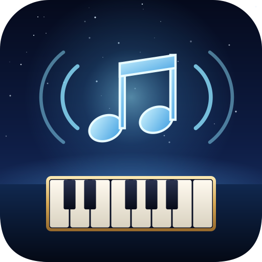

# XivPiano



**[Install](https://spacegho.st/mods/ffxiv/plugins/) · [Changelog](CHANGELOG.md)**

**Your Pandora stations inside FINAL FANTASY XIV.**

XivPiano is a Dalamud plugin that plays Pandora radio in the game, in the tradition of
[pianobar](https://github.com/PromyLOPh/pianobar), [Pithos](https://github.com/pithos/pithos) and
[Elpis](https://github.com/adammhaile/Elpis): sign in, pick a station, and it plays while you do everything else.
Thumbs up and down teach the station, *tired of it* shelves a song for a month, and a search makes a new station
from any artist, song or genre.

> **Status: experimental, not heard in game yet.** Host tests cover the Blowfish cipher against its published test
> vectors, Pandora's request wrapping, the login sequence, playlists, feedback, search, the radio queue (skipping
> expired and broken links, refilling before it runs dry) against a fake Pandora, and the partner login has been
> checked against Pandora itself. Sound, the window and the game-side behaviour are implemented intent until they
> have been seen working.

> **Pandora only serves the United States**, and you need a Pandora account (free or paid). XivPiano is not
> affiliated with Pandora or Sirius XM.

## What you get

- **Your stations**, with a filter, and **Shuffle** where your account has it.
- **Now playing**: album art, title, artist, album, a progress bar and the station. The Copy button copies a song line and public Pandora link; choose a restricted chat channel before pasting. It never sends chat.
- **Play / pause, next song, thumbs up, thumbs down** (also skips), **tired of it** (not for a month, on any
  station), **bookmark** the song (right-click: the artist), and **why this song?** in Pandora's own words.
- **New stations** from a search (artist, song or genre), or from the song or artist that is playing.
- **Manage stations** (right-click one): rename, delete, in or out of **Shuffle**, and its **seeds, thumbs and
  modes**: add variety, remove a seed, take back a thumb, switch Pandora's station modes. Sort A to Z.
- **History** of the last 20 songs, each still rateable and bookmarkable; **Up next**; **Open on Pandora**; Pandora's
  **genre stations** to browse.
- **Scrobbling** to **Spaceghost Scrobbles** (stored history and forwarding), **Last.fm** (your own free API key) and **ListenBrainz** (your user token).
- **Toasts** for new songs, the keyboard's **media keys**, and Pandora's **explicit content filter**.
- **Song-change IPC** for other plugins, alongside the existing Now Playing and playback-control gates. See [IPC contract](docs/IPC.md).
- **The song in the server info bar**: click opens XivPiano, right-click pauses.
- **Duty music priority**: select duty types where the radio pauses for the game’s music; cutscene and duty pause reasons wait for each other before resuming.
- **Dialogue volume**: opt-in lowering while a Talk window is open, with an adjustable fraction and a short fade back to your current volume.
- **Plays nicely with the game**: mutes the game's background music while a song plays and puts it back as it was,
  pauses during cutscenes and resumes after, and can say each new song in chat.
- **Stays signed in if you want**: the password is encrypted for your Windows (or Wine) user with DPAPI before it
  is saved, and XivPiano can resume your last station when the game starts.

## Pandora Plus and Premium

A paid account streams **192 kbit/s MP3** (free accounts get 128), as it does in Elpis, pianobar and Pithos.
XivPiano recognises a paid account from Pandora's own flags (subscriber, or no audio ads) and asks for the
192 kbit/s stream through the ordinary Android client, the way Elpis does. When Pandora does not offer it there,
XivPiano signs in again as the Pandora One client, the way Pithos does for subscribers, and uses that client's
192 kbit/s stream. In *Settings*:

- **Audio quality**: *best my account gets*, or *128 kbit/s* to save data.
- **Pandora client**: *automatic* (the above), *Android* (as Elpis and pianobar), or *Pandora One* (as Pithos;
  a free account falls back to Android).

The window shows your plan, the client in use and each song's bitrate.

## Requirements

- FFXIV with Dalamud (API 15), on Windows or on Linux under Wine. Songs are MP3 (128 kbit/s, or 192 on Plus and Premium), decoded in managed
  code ([NLayer](https://github.com/naudio/NLayer)) and played through winmm ([NAudio](https://github.com/naudio/NAudio)),
  so nothing depends on Windows codecs.
- A Pandora account (free, Plus or Premium), in the United States.

## Scrobbling

To keep listening history with [Spaceghost Scrobbles](https://spacegho.st/mods/ffxiv/scrobble/), open its dashboard,
connect any Last.fm or ListenBrainz accounts you want it to forward to, and create a client token. In XivPiano's
**Settings → Scrobbling**, enable **Spaceghost Scrobbles**, paste the token, then choose **Save and check connection**.
The token is encrypted for your Windows/Wine user. The connection check validates the token without submitting a listen.

The host receives public song metadata and listening timestamps; Pandora credentials, stream URLs and account
tokens are excluded. Forwarding is managed in the host dashboard. Keep a direct Last.fm/ListenBrainz destination
off in XivPiano when the host forwards to that same account, to avoid duplicates. Direct scrobbling remains available.
The service URL can point to another compatible HTTPS host.

## Commands

| Command | Does |
|---|---|
| `/piano` | open or close XivPiano |
| `/piano play`, `/piano pause` | play or pause |
| `/piano next` | next song |
| `/piano love`, `/piano ban` | thumbs up; thumbs down (and skip) |
| `/piano tired` | not for a month (and skip) |
| `/piano stop` | stop |
| `/piano station <name>` | tune in to the first station whose name contains `<name>` |

They work in macros too.

## For other plugins

| IPC gate | Type | Does |
|---|---|---|
| `XivPiano.NowPlaying` | `string ()` | JSON: `playing`, `station`, `title`, `artist`, `album`, `loved`, `positionSeconds`, `lengthSeconds` |
| `XivPiano.Control` | `bool (string action)` | `play`, `pause`, `toggle`, `next`, `love`, `ban`, `tired`, `stop`; false when unknown or not signed in |

## How it talks to Pandora

XivPiano uses [melodica.h](https://github.com/Spaceghost/melodica.h)'s C libpiano implementation
for request construction, Blowfish, login and response validation. Its source is vendored at the immutable
`v1.0.0` commit with per-file hashes and the original MIT notice. A narrow C ABI bridge is loaded as a
Windows x64 DLL on Windows and Wine; Linux host tests use the matching `.so`.

Managed `HttpClient` supplies HTTPS. Account policy, paid-account quality fallback, extra MP3 selection,
genre results and track timestamps remain in the managed client. Native sessions are serialized across each
HTTP transaction and released on sign-out or unload. Sign-out and account switches cancel stale requests.
The managed Blowfish implementation is retained as an independent test oracle; runtime requests use melodica.
See [the native bridge contract](native/README.md) for ownership, metadata adaptation and error handling.

## Building

```sh
tools/fetch-dalamud.sh
tools/fetch-zig.sh
export ZIG="${RUNNER_TEMP:-/tmp}/xivpiano-zig-0.16.0/zig"
dotnet test tests/XivPiano.Core.Tests
dotnet build src/XivPiano.Plugin/XivPiano.Plugin.csproj -c Release
tools/install-dev.sh
```

Build on Linux x86_64 with GCC and the pinned Zig cross compiler. The project builds its Linux test library
and Windows plugin DLL automatically. `tools/test-melodica-native.sh` runs the real shared-library checks;
`tools/test-melodica-sanitizers.sh` checks native ownership; `tools/test-melodica-managed-windows.sh` runs
the full offline managed suite from an extracted Windows deployment under Wine/Xvfb.

`XIVPIANO_LIVE=1 dotnet test tests/XivPiano.Core.Tests` also checks the partner login against Pandora itself.

## License

MIT. NAudio, NLayer and melodica/libpiano are MIT as well. The plugin package includes melodica's retained notices.
